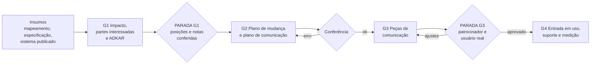

# 00. Visão geral: do sistema especificado ao sistema adotado

Um sistema pronto não é um sistema usado. A especificação diz **o que** o sistema faz; este framework diz **como as
pessoas vão passar a usá-lo**: quem é afetado, o que muda para cada um, quem resiste e por quê, o que cada grupo
precisa saber e quando, e com que peça.

A entrada é o projeto do aluno, com o mapeamento do processo e a especificação do sistema. A saída tem duas formas:

- um **plano de implantação** rastreável: impacto, partes interessadas, ADKAR, ações, comunicação, capacitação,
  suporte e indicadores de adoção;
- **peças de comunicação prontas**: guia rápido, manual com telas, perguntas frequentes, apresentação para a
  diretoria, roteiro de vídeo e comunicado aos regulados.

## 1. Por que sistemas bons falham na implantação

As causas se repetem, no setor público e no privado:

- **Ninguém explicou o porquê.** As pessoas recebem a ferramenta sem entender o problema que ela resolve (falha de
  Consciência, no ADKAR).
- **A chefia intermediária não comprou a ideia.** O patrocinador anuncia, mas o chefe imediato continua cobrando do
  jeito antigo. É o grupo que mais pesa na adoção e o mais esquecido no plano.
- **Treinamento genérico, na hora errada.** Curso de "funcionalidades" semanas antes do uso, sem o caso real de quem
  vai operar.
- **Sem suporte nas primeiras semanas.** A primeira dúvida sem resposta vira planilha paralela.
- **Ninguém mede o uso.** O sistema "entrou em produção", mas não se sabe quantos o usam, nem se o processo melhorou.
- **Anúncio antes da escuta.** Quem ia resistir fica sabendo junto com todo mundo e passa a resistir em público.

## 2. Fluxo

| Etapa | Capítulo | Produto | Onde fica no projeto |
|---|---|---|---|
| Reunir os insumos | [01](01_INSUMOS.md) | Mapeamento, especificação, endereço do sistema, data prevista | `insumos/` e `implantacao/README.md` |
| Impacto e partes interessadas | [02](02_IMPACTO_E_PARTES_INTERESSADAS.md) | O que muda para quem; mapa poder × interesse | `implantacao/01_IMPACTO_DA_MUDANCA.md`, `02_PARTES_INTERESSADAS.md` |
| Diagnóstico ADKAR | [03](03_DIAGNOSTICO_ADKAR.md) | Notas por parte interessada e ponto de bloqueio | `implantacao/03_DIAGNOSTICO_ADKAR.md` |
| Plano de mudança | [04](04_PLANO_DE_MUDANCA.md) | Patrocínio, resistências, ações, capacitação, suporte, indicadores | `implantacao/04_` a `07_` |
| Comunicação | [05](05_COMUNICACAO.md) | Plano de comunicação e peças | `implantacao/05_PLANO_COMUNICACAO.md`, `implantacao/material/` |

## 3. Identificadores

Todo item tem identificador. Os documentos se referem uns aos outros só por eles, e o conferidor confere as ligações.

| Prefixo | Item | Definido em | Liga com |
|---|---|---|---|
| `IMP-nn` | Impacto: o que muda, para quem | `01_IMPACTO_DA_MUDANCA.md` | origem na especificação (`MOD-`, `UC-`, `TL-`, `PER-`, `M-`) e `PI-` |
| `PI-SIG` | Parte interessada (grupo, nunca pessoa) | `02_PARTES_INTERESSADAS.md` | `PER-` da especificação, quando usa o sistema |
| — | Notas ADKAR por `PI-` | `03_DIAGNOSTICO_ADKAR.md` | toda `PI-` tem uma linha |
| `AC-nn` | Ação de gestão de mudança | `04_PLANO_GESTAO_MUDANCA.md` | `PI-` e elemento ADKAR tratado |
| `CM-nn` | Comunicação planejada | `05_PLANO_COMUNICACAO.md` | `PI-` (ou "Todos") e, se houver, `AC-` |
| `CAP-nn`, `SUP-nn` | Capacitação e suporte | `06_CAPACITACAO_E_SUPORTE.md` | `PI-` |
| `IND-AD-nn` | Indicador de adoção | `07_INDICADORES_DE_ADOCAO.md` | `PI-` e, se houver, indicador do mapeamento |
| `PC-nn` | Peça de comunicação | `material/*.md` | `CM-` que a pede |
| `DEC-nn` | Decisão pendente | `implantacao/README.md` | qualquer item |

## 4. Três tipos de etapa

| Tipo | Quem faz | Exemplos | Como se confere |
|---|---|---|---|
| Determinística | Script | Ligações entre identificadores, ponto de bloqueio do ADKAR, escuta antes do anúncio, aviso de IA | `conferir_implantacao.py` |
| Julgamento | Pessoa ou IA, seguindo o método | Impactos, posições, notas ADKAR, mensagens, peças | Conferidor (forma) e revisão humana (conteúdo) |
| Decisão | Pessoas do órgão | Quem patrocina, data de entrada em uso, se haverá operação em paralelo, o que muda para o regulado | PARADA, com `DEC` registrada |

## 5. O que não se negocia

- **Origem em tudo.** Impacto com origem na especificação; posição e nota com evidência ou `[A CONFIRMAR]`.
- **Quem resiste é ouvido antes do anúncio geral.**
- **Patrocínio visível.** O patrocinador (uma função de direção) aparece no plano com o que ele mesmo comunica.
- **Peça com dono.** Nenhuma peça sem a linha do plano que a pede.
- **Transparência e acessibilidade.** Aviso de IA quando há voz ou imagem sintética; legenda e transcrição no vídeo.
- **Função, não nome.** E nenhum dado pessoal em captura de tela.
- **Verificação humana.** A IA rascunha; uma pessoa confere antes de qualquer peça chegar ao público.
