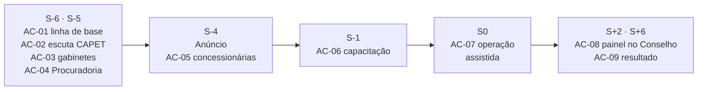

# 04. Plano de gestão de mudança

S0 é o início da operação assistida do piloto. As ações seguem o ponto de bloqueio de cada parte (03): primeiro
Consciência para quem tem poder alto, Desejo para quem perde domínio, e só depois Conhecimento e Habilidade.

## 1. Patrocínio e coalizão

| Papel | Função | O que faz pessoalmente |
|---|---|---|
| Patrocinador | Presidência do Conselho-Diretor (DEC-01) | Apresenta a linha de base e o porquê; afirma que a homologação continua com o Conselho; passa a acompanhar o processo pelo painel |
| Dono do processo | Chefia da CAPET | Leva os analistas para a validação do motor; responde pelo parecer técnico gerado com o sistema |
| Chefias intermediárias | Chefe de gabinete de cada relator, chefia da Secretaria Executiva, coordenação da Procuradoria | Cobram pelo sistema depois de S0; indicam o multiplicador |
| Multiplicadores | Um analista da CAPET, um servidor da Secretaria, um assessor de gabinete | Tiram dúvidas na unidade de S0 a S+6 |

## 2. Resistências

| Parte | Perda percebida | Evidência | Resposta |
|---|---|---|---|
| PI-ANA | Domínio (o cálculo era a expertise do grupo) e exposição (o recálculo mostra parecer que não fecha) | Cálculo à mão repetido em 13 de 18 casos; 2 pareceres que não fecham [A CONFIRMAR] | AC-02 |
| PI-PRO | Segurança jurídica (peça com minuta gerada por sistema) | Peças de 58 a 71 laudas por caso; nenhuma experiência com minuta assistida [A CONFIRMAR] | AC-04 |
| PI-REL | Exposição (a idade do ciclo no gabinete fica visível) | Maior posse por caso: mediana de 74,5 du [A CONFIRMAR] | AC-03 |

## 3. Ações

| ID | Ação | Partes | Elemento ADKAR | Origem | Momento | Responsável |
|---|---|---|---|---|---|---|
| AC-01 | Apresentar a linha de base do processo (337,5 du de mediana; 17 caminhos em 18 casos) e o que continua com o Conselho | PI-REL, PI-PRO, PI-CHE | Consciência | ADKAR PI-REL, ADKAR PI-PRO | S-6 | Presidência do Conselho-Diretor |
| AC-02 | Ouvir os analistas e convidá-los a validar o motor com os 28 cálculos refeitos antes de qualquer anúncio | PI-ANA, PI-CHE | Desejo | ADKAR PI-ANA, ADKAR PI-CHE, IMP-01 | S-6 | Chefia da CAPET |
| AC-03 | Conversar com cada gabinete sobre o painel de prazos: o que será visto, por quem, e o ganho da reiteração automática | PI-REL | Consciência | ADKAR PI-REL, IMP-04 | S-5 | Presidência do Conselho-Diretor |
| AC-04 | Validar com a Procuradoria o checklist legal e a regra de citação verificada antes de usar minuta em ciclo real | PI-PRO | Consciência | ADKAR PI-PRO, IMP-05 | S-5 | Coordenação da Procuradoria |
| AC-05 | Reunião técnica com as concessionárias do piloto sobre o layout do pleito e a validação prévia | PI-CON | Consciência | ADKAR PI-CON, IMP-03 | S-4 | Chefia da CAPET |
| AC-06 | Capacitar por perfil, com o ciclo de Paraty 2026 em homologação como exercício | PI-GCA, PI-SEC, PI-TI, PI-ANA | Conhecimento | ADKAR PI-GCA, ADKAR PI-SEC, ADKAR PI-TI | S-1 | Equipe do projeto |
| AC-07 | Operação assistida: o pleito real entra pelo sistema e a CAPET refaz a conta pelo método atual | PI-ANA, PI-SEC | Habilidade | IMP-01, IMP-07 | S0 | Chefia da CAPET |
| AC-08 | Conselho passa a pautar o acompanhamento do processo pelo painel de indicadores, todo mês | PI-DIR | Reforço | ADKAR PI-DIR, IMP-09 | S+2 | Presidência do Conselho-Diretor |
| AC-09 | Divulgar o resultado do piloto (antes e depois) e reconhecer as unidades | PI-DIR, PI-ANA, PI-REL | Reforço | IMP-09 | S+6 | Presidência do Conselho-Diretor |

## 4. Linha do tempo

